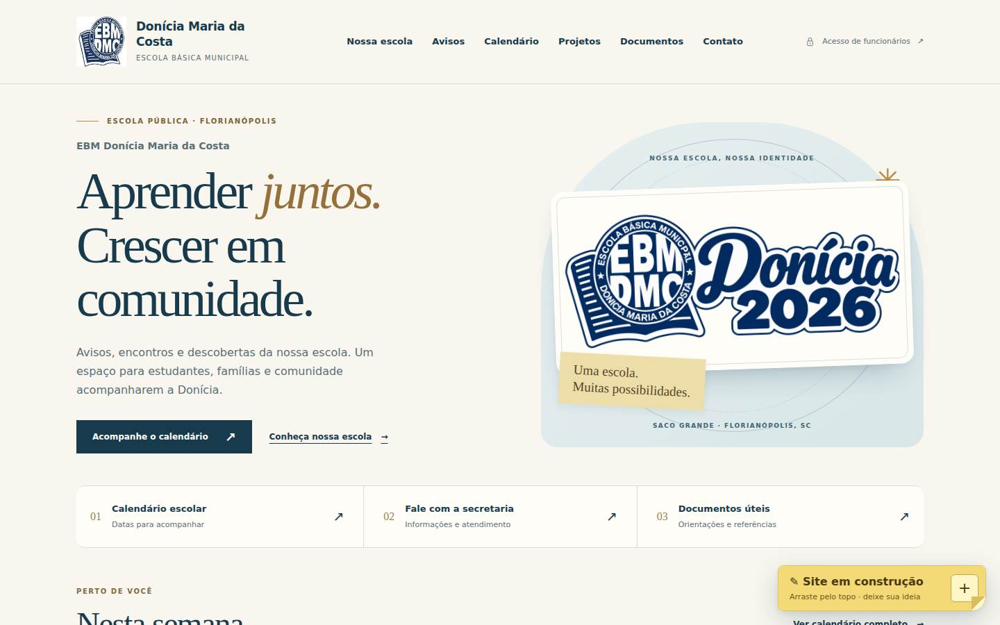
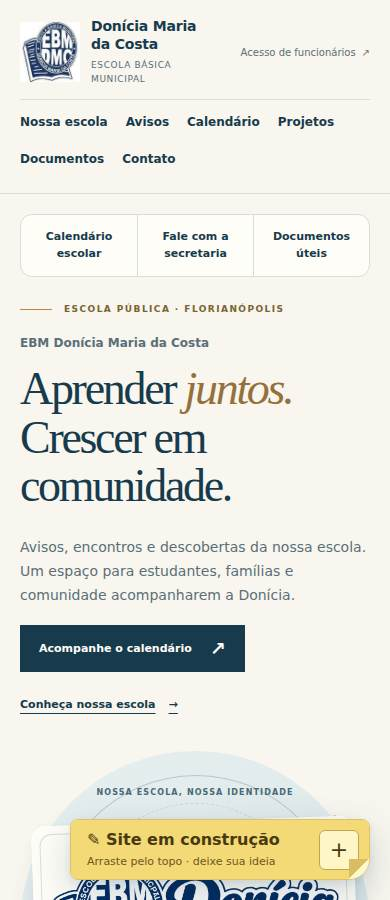
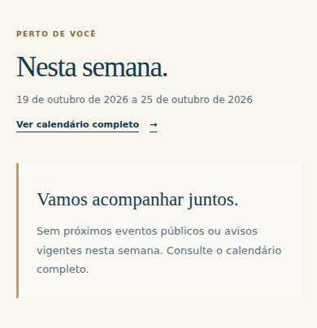
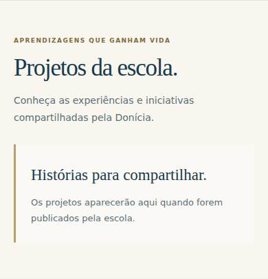
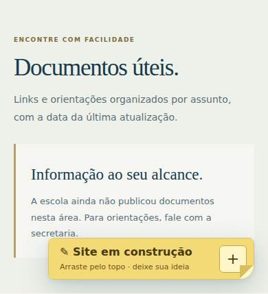
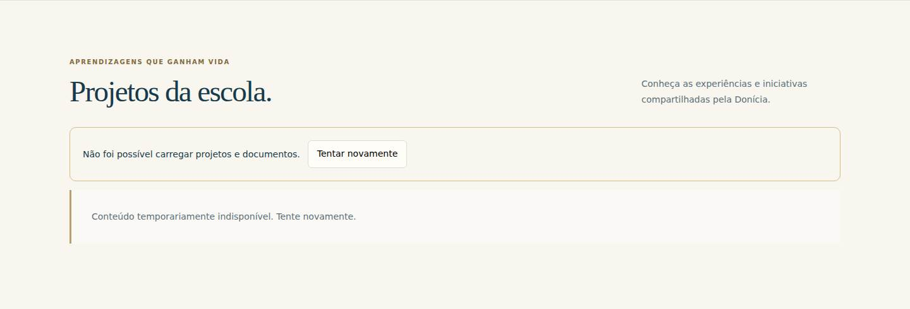
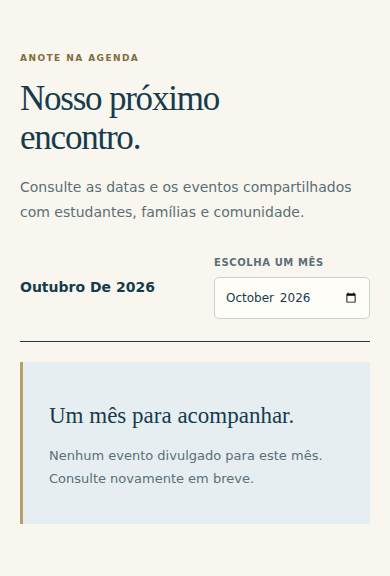
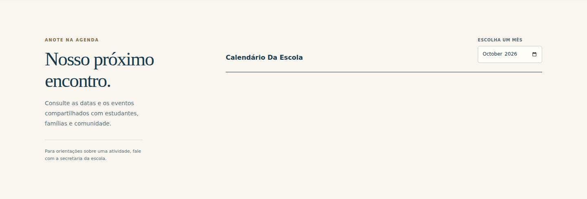
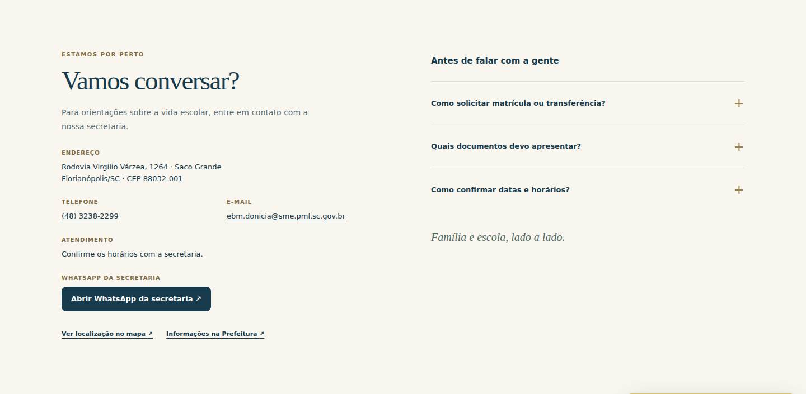

# Revisão da área pública — 21 de outubro de 2026

O portal abre sem autenticação e tem uma identidade visual consistente. A principal pendência é editorial: **nenhum projeto, documento, aviso, evento ou destaque estava publicado durante a revisão**. Há também falhas de recuperação de dados, ajustes de calendário e pontos de acessibilidade a corrigir.

Escopo: [portal publicado](https://organizadordonicia.carijo.workers.dev/), código no commit [3c4c6a4](https://github.com/marianojogos-art/OrganizadorDonicia/commit/3c4c6a4b58552b39a834097d2cc9472358b8a704), navegação pública em Chromium, larguras 320, 390, 768 e 1440 px. Capturas reais feitas em 21/10/2026 às 23h57, horário de Brasília, pelo [GitHub Actions](https://github.com/marianojogos-art/OrganizadorDonicia/actions/runs/39714136209). Todas as requisições de escrita à produção foram bloqueadas; as falhas de rede foram simuladas apenas no navegador de teste.

Esta entrega registra a auditoria e um roteiro reutilizável. **Não altera o leiaute, os dados publicados ou as permissões do portal.**

1. **Entrada, identidade e navegação — boa base, ajustes pontuais.**

   Logo nítido, nome da escola evidente, cores coerentes e entrada de funcionários discreta. Atalhos aparecem antes da apresentação no celular. Nenhuma rolagem horizontal ou imagem quebrada nas quatro larguras. O salto “Ir para o conteúdo” recebeu o primeiro foco; a navegação por teclado até Contato funcionou.

   No celular, o post-it amarelo de 300 px ocupa grande parte da largura e cobre conteúdo, mesmo recolhido. As capturas mostram sobreposição na imagem e em Documentos/FAQ. Recomenda-se substituí-lo por um botão compacto “Enviar sugestão”, abrindo o formulário por ação do visitante. A apresentação também ocupa mais de uma tela antes de “Nesta semana”; reduzir sua altura ajudaria a destacar informação útil.

   

   

2. **Nesta semana e avisos — estrutura pronta, conteúdo ausente e erro ambíguo.**

   As APIs responderam 200 com listas vazias de eventos, avisos e destaques. O estado vazio é honesto, mas não entrega a agenda esperada. Publicar eventos e avisos reais, com responsável e validade, é a primeira prioridade editorial.

   O texto “Sem próximos eventos públicos ou avisos vigentes” é impreciso: o bloco consulta apenas avisos escolhidos como destaque. Pode haver avisos publicados no mural sem destaque. O mesmo texto apareceu quando a API de destaques recebeu 503 no teste. Recomenda-se separar “nenhum destaque publicado” de “não foi possível carregar”, com nova tentativa no próprio bloco. [Código, linhas 120–131](https://github.com/marianojogos-art/OrganizadorDonicia/blob/3c4c6a4b58552b39a834097d2cc9472358b8a704/src/public.html#L120).

   

3. **Projetos e documentos — prioridade editorial alta; falha funcional confirmada.**

   `/public/content` respondeu `{"items":[]}`. Portanto, os primeiros projetos reais do Instagram ainda não estão visíveis, e não há documentos para consultar. As categorias, imagens, links e datas de atualização previstas no código só poderão ser avaliadas com publicações aprovadas. Não foi criado conteúdo fictício nesta revisão.

   Uma falha apenas em `/public/highlights` faz projetos e documentos exibirem erro, mesmo com resposta saudável de `/public/content`. Reproduzido na página real com uma resposta 503 simulada. **Prioridade P2:** carregar esses conjuntos independentemente e manter os dados que chegaram. [Código, linha 144](https://github.com/marianojogos-art/OrganizadorDonicia/blob/3c4c6a4b58552b39a834097d2cc9472358b8a704/src/public.html#L144).

   

   

   

4. **Calendário — navegação funciona, recuperação precisa melhorar.**

   O seletor mudou de outubro para novembro e atualizou o título. Não há eventos publicados na API, logo não foi possível verificar a exatidão de datas reais.

   - **P2:** uma falha inicial em `/public/api` deixa o calendário vazio, sem mensagem ou botão naquele local; o erro aparece longe, em Avisos. Reproduzido no navegador. Incluir carregamento, erro e nova tentativa junto à agenda.
   - **P2:** eventos do mesmo dia são ordenados alfabeticamente pelo título, sem considerar o horário. Reproduzido com dados sintéticos no JS original: encerramento às 16h aparece antes de abertura às 8h. Ordenar por data, horário e título.
   - **P3:** limpar o campo mês e recarregar dados chama formatação de uma data inválida; uma resposta válida acaba tratada como erro de rede. Reproduzido em memória, não com dados reais. Validar o mês dentro de `renderCalendar()`.

   Evidência: [public.html, linhas 104–109](https://github.com/marianojogos-art/OrganizadorDonicia/blob/3c4c6a4b58552b39a834097d2cc9472358b8a704/src/public.html#L104) e [tratamento de erro, linha 154](https://github.com/marianojogos-art/OrganizadorDonicia/blob/3c4c6a4b58552b39a834097d2cc9472358b8a704/src/public.html#L154). O idioma do texto interno do campo mês depende do navegador; a captura do runner mostra “October”, enquanto o título do portal está em português.

   

   

5. **Contato, redes e dúvidas — úteis, com verificações pendentes.**

   Endereço, CEP, telefone e e-mail correspondem ao [cadastro municipal](https://servicos.floripa.sc.gov.br/atendimento/servico-info/659). Telefone e e-mail são acionáveis; WhatsApp, mapa e Prefeitura têm atalhos. FAQ abriu pelo teclado.

   Falta publicar o horário confirmado de atendimento; hoje o visitante precisa perguntar à secretaria. A apresentação e os contatos funcionam por valores de reserva no código porque o perfil retornado pela API ainda tem campos vazios. Recomenda-se consolidar os dados verificados no cadastro administrável, para facilitar manutenção futura.

   O Instagram corresponde ao perfil informado pelo responsável. O Facebook tem referência no [portal institucional de 2020](https://sites.google.com/sme.pmf.sc.gov.br/ebmdoniciamariadacosta2020/p%C3%A1gina-inicial). As plataformas Meta limitaram a consulta automatizada; não há evidência para declarar os links quebrados. O WhatsApp configurado não foi confirmado em fonte pública atual nem por envio de mensagem; não alterar dígitos por suposição.

   

6. **Acessibilidade, desempenho e separação de acesso — base saudável, sem certificação integral.**

   A página tem idioma pt-BR, um h1, menus nomeados, campo mês com rótulo, FAQ nativo, foco visível em fundo claro e respeito à redução de movimento. Textos essenciais da navegação, agenda e contato têm contraste calculado suficiente.

   Ajustes de acessibilidade:
   - **P2:** contorno de foco dos links sociais tem contraste 2,705:1 com o fundo escuro. Usar contorno claro nessa faixa; referência [WCAG 1.4.11](https://www.w3.org/WAI/WCAG22/Understanding/non-text-contrast.html).
   - **P3:** pequenos rótulos dourados em Avisos e Documentos têm contraste 4,418:1 e 4,463:1, abaixo de 4,5:1. Escurecer a cor; referência [WCAG 1.4.3](https://www.w3.org/WAI/WCAG22/Understanding/contrast-minimum.html).
   - Ampliar textos auxiliares de 9–11 px, alvos de telefone/e-mail/funcionários e a borda do mês. Alvos pequenos não foram classificados automaticamente como falha: a norma tem exceções de espaçamento e texto em linha.
   - Alinhar ordem visual e de teclado dos atalhos no celular. Hoje o CSS muda a posição visual, enquanto o DOM mantém os links de apresentação antes deles.
   - Substituir “Ver conteúdo” por nomes específicos nos destaques e informar nova aba também nos links Mapa e Prefeitura.

   Desempenho: a imagem principal tem **1.497.321 bytes de conteúdo** e transferiu **1.497.621 bytes** por visita no teste; corresponde a aproximadamente 98,6% dos bytes dos subrecursos medidos. O código serve também imagens com `Cache-Control: no-store`. Recomenda-se imagem responsiva comprimida e cache para ativos com versão. A navegação do runner teve TTFB de aproximadamente 95–213 ms e evento load de 224–399 ms nesta coleta, mas **não são medidas de celular em rede móvel, LCP, INP ou CLS**. Não foi atribuída nota Lighthouse.

   As [34 verificações HTTP anônimas](https://github.com/marianojogos-art/OrganizadorDonicia/actions/runs/38989899495) passaram em nova execução nesta revisão: páginas públicas acessíveis, rotas da equipe redirecionadas ao Cloudflare Access e imagens inexistentes com 404. A revisão das projeções públicas não encontrou campos de autoria ou registros internos expostos. Isso não substitui teste de invasão ou revisão completa de todos os perfis autenticados.

**Ordem recomendada de execução**

1. Publicar projetos aprovados, documentos úteis, próximos eventos e avisos reais; confirmar horários da secretaria.
2. Separar as consultas e os estados de erro, recuperar o calendário no próprio local e corrigir ordenação/validação do mês.
3. Compactar o post-it no celular e corrigir contrastes/foco.
4. Otimizar a imagem principal e o cache de ativos; medir novamente em rede móvel simulada.
5. Repetir a revisão com conteúdo real, leitor de tela e navegadores móveis físicos.

**Limites e registro**

Sem envio de formulário, mensagem ou cadastro em produção. Sem acesso ao computador pessoal. Não foram testados leitor de tela real, Safari/iOS, Android físico, entrega de WhatsApp/e-mail ou publicações da Meta. O formulário de sugestão abriu/recolheu; envio real ficou fora do teste. As falhas descritas continuam pendentes: esta PR documenta a revisão, não sua correção.

O roteiro de auditoria e as capturas estão neste repositório. As capturas de falha foram produzidas por interceptação temporária no navegador de teste; não indicam que o servidor estava indisponível durante a revisão.
